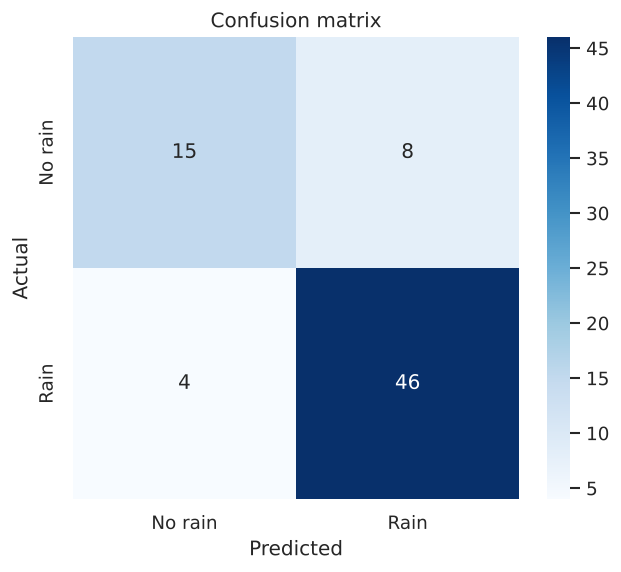
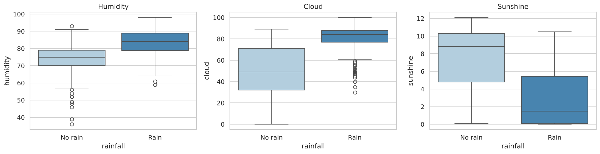
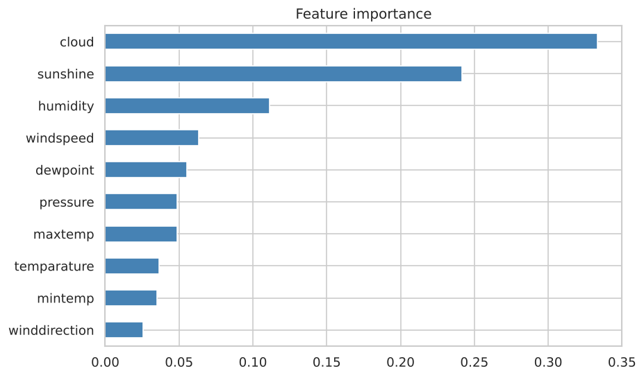

# 🌧️ Rainfall Prediction with Random Forest

Predicts whether it will rain on a given day from daily weather measurements, using a tuned Random Forest.



## Results

| Metric (test set, 73 days) | Score |
|---|---|
| Accuracy | **83.6%** |
| F1 (rain) | **0.885** |
| Recall (rain) | **0.92** |
| Precision (rain) | 0.85 |

The model **rarely misses a rainy day** (recall 0.92) at the cost of a few false alarms. For a weather app this is the right trade-off: telling someone to take an umbrella on a dry day is cheaper than missing the rain.

## Approach

1. **Cleaning** – stripped stray spaces from column names, removed the 2 rows with missing values, encoded `rainfall` (yes/no → 1/0).
2. **Removed the `day` column** – it is only a day-of-month counter with no physical meaning.
3. **EDA** – rainy days have higher humidity and cloud cover and far less sunshine.
4. **Model** – `Pipeline` (mean imputer → Random Forest), stratified 80/20 split, **GridSearchCV** over 324 hyper-parameter combinations with 5-fold CV, optimising F1.

| EDA | Feature importance |
|---|---|
|  |  |

## Dataset

`data/Rainfall.csv` — 366 daily records: pressure, max/min/mean temperature, dew point, humidity, cloud, sunshine, wind direction and speed.

## Run it

```bash
pip install -r requirements.txt
jupyter notebook rainfall_prediction.ipynb
```

**Tech:** Python · pandas · scikit-learn · seaborn

---

## 👤 Author

**Reda Akram** — Computer Science (AI) student at the University of Technology, Baghdad. I build ML models, automation systems and AI agents.

GitHub: [@devb777r](https://github.com/devb777r)
